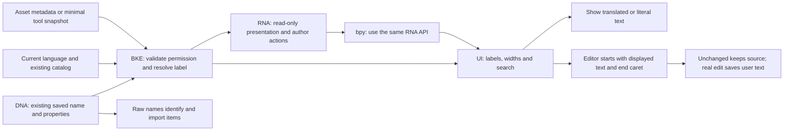
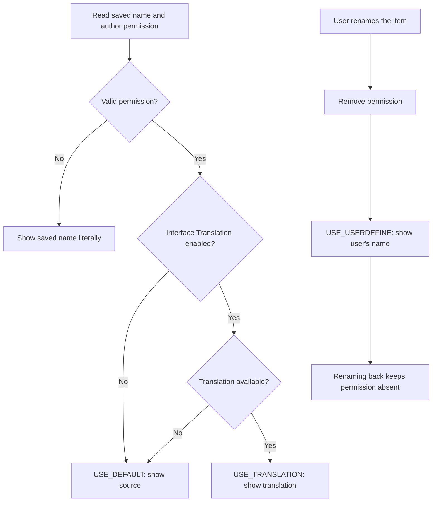
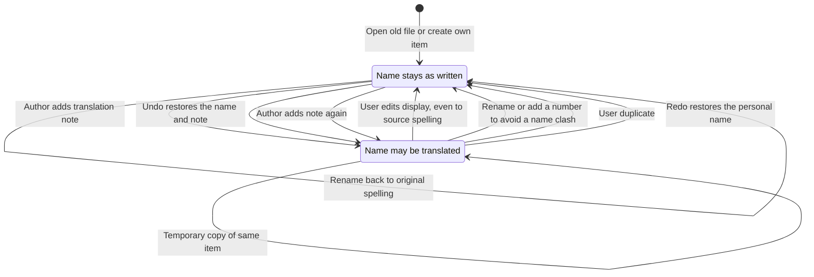
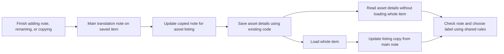
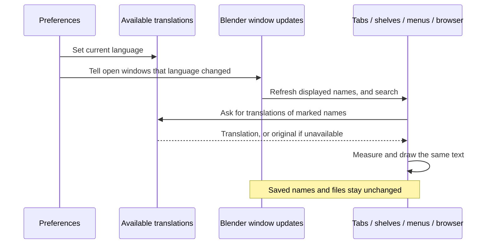
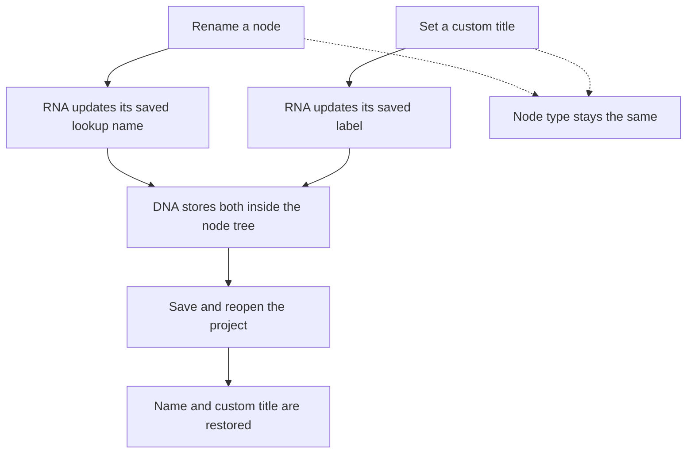

# Implementation: one saved name, one derived label

Updated 2026-10-04. Matches the current source; final runtime results are in [verification](20261003_231111_verification.md). This explanation uses ordinary English first, followed by concrete developer details.

## Why the shared design is smaller

The first proposal needed workspace-specific saved labels and editing rules. This implementation keeps normal naming and adds one author permission note usable by saved IDs. The same resolver handles a workspace tab, a brush, a tool node group, and an asset listing. Three presentation outcomes are derived; no enum, second editable name, per-item locale, or translated identity is saved.

The source name is the key scripts and files use. A translated label is temporary presentation. User rename means “show exactly what I wrote”; changing the spelling back does not erase that decision.

## DNA → BKE → RNA → bpy → UI audit

| Layer | Responsibility | Concrete implementation |
| --- | --- | --- |
| DNA | Existing saved structures | `ID.name`, `ID.system_properties`, `AssetMetaData.properties`; no DNA changes. |
| BKE | Author note and policy | `BKE_id_ui_name.hh`, `intern/id_ui_name.cc`, ID rename/copy hooks, override replacement hooks. |
| File loading | Validate saved state | Existing property serialization and `BKE_id_ui_name_copy_finalize` after read. No spelling inference. |
| RNA | Safe API | Read-only `ui_name`, `ui_name_is_translatable`, `ui_name_translation_context`; explicit `ui_name_translation_mark()` / `ui_name_translation_clear()` with normal editability checks and notifications. |
| bpy | Python access | Uses RNA directly; `.name` remains the normal rename API. |
| UI | Presentation, editing and search | BKE shared resolution; Python brush header reads `.ui_name`; saved identity remains `.name`. Temporary selected-language editing described below; saved names stay unchanged. |

## Stored permission

`_blender_ui_name` is an IDProperty group with integer `version = 1` and UTF-8 `source`. Validation checks group/field types, version, bounded string storage, valid UTF-8 and exact name equality. Unknown, malformed or stale notes fall back to source. Clearing removes only this note; other system/asset properties survive. Linked and runtime-only WindowManager IDs cannot be explicitly marked. Marking requires editability.

The existing asset metadata serializer/index carries the copied note without a new index format. Local assets resolve their loaded ID; external listings resolve their source name and saved metadata. Loading the ID resynchronizes the listing from the main note.

## Exact shared API

The following is copied from `source/blender/blenkernel/BKE_id_ui_name.hh`:

```cpp
/* SPDX-FileCopyrightText: 2026 Blender Authors
 *
 * SPDX-License-Identifier: GPL-2.0-or-later */

#pragma once

#include <string>

#include "BLI_string_ref.hh"

namespace blender {

struct ID;
struct IDProperty;

/** Resolve without allocation or mutation. The result is borrowed until ID/locale changes. */
StringRefNull BKE_id_ui_name_resolve(short id_type,
                                   StringRefNull name,
                                   const IDProperty *properties);
StringRefNull BKE_id_ui_name_get(const ID &id);

/** Keywords for existing fuzzy search: source and distinct display text, one result per ID. */
std::string BKE_id_ui_name_search_text(short id_type,
                                      StringRefNull name,
                                      const IDProperty *properties);

/** Explicit author opt-in. Linked and runtime-only IDs cannot be marked. */
bool BKE_id_ui_name_mark(ID &id);
bool BKE_id_ui_name_is_translatable(const ID &id);
/** Remove only the translation note, preserving other system and asset properties. */
void BKE_id_ui_name_clear(ID &id);
/** Project the ID-owned note into asset metadata for listings before import. */
void BKE_id_ui_name_asset_sync(ID &id);
/** Owned minimal property root for registration snapshots; null when no matching author note. */
IDProperty *BKE_id_ui_name_properties_copy(StringRefNull name, const IDProperty *properties);
/** Internal replacement: transfer a matching explicit note, including a deliberate absence. */
void BKE_id_ui_name_copy(ID &destination, const ID &source);
/** Validate after properties have been copied and the final name has been assigned. */
void BKE_id_ui_name_copy_finalize(ID &id);

}  // namespace blender

```

The resolution and search implementation below is copied from `source/blender/blenkernel/intern/id_ui_name.cc`:

```cpp
StringRefNull BKE_id_ui_name_resolve(const short id_type,
                                   const StringRefNull name,
                                   const IDProperty *properties)
{
  /* Unmarked names take the cheap path; the translator also protects background callers. */
  const bool should_translate = BLT_translate_iface() && descriptor_matches(properties, name);
  if (!should_translate) {
    return name;
  }
  const char *context = BKE_idtype_idcode_to_translation_context(id_type);
  const char *translated = BLT_translate_do_iface(context, name.c_str());
  const bool has_translation = translated && translated[0] != '\0';
  return has_translation ? StringRefNull(translated) : name;
}

StringRefNull BKE_id_ui_name_get(const ID &id)
{
  return BKE_id_ui_name_resolve(short(id.id_type()), BKE_id_name(id), id.system_properties);
}

std::string BKE_id_ui_name_search_text(const short id_type,
                                      const StringRefNull name,
                                      const IDProperty *properties)
{
  const StringRefNull display = BKE_id_ui_name_resolve(id_type, name, properties);
  const bool has_distinct_display = display != name;
  if (!has_distinct_display) {
    return name;
  }
  return std::string(name) + " " + std::string(display);
}


```

The returned `StringRefNull` borrows ID or catalog storage. Consume it in the current draw operation; copy into an owned string for records kept longer. The normal draw path allocates no string. Cheap Interface Translation checks run before note validation. Search includes a distinct translated alias in one result's keywords; it never creates a duplicate identity.

## Lifecycle integration

Normal ID naming detects actual name changes, including forced collision changes, and clears permission on the affected item. Copies are validated after the final unique name. User duplicates clear permission even when they can keep the same spelling in a different Main. Temporary/internal copies retain valid permission. RNA `.copy()` also follows the personal-copy policy.

Library overrides need one extra distinction: initial replacement can temporarily acquire a collision name; copy the reference's matching note after assigning the final name. Refreshing an existing override transfers the local note or deliberate absence after restoring the local name. This prevents either temporary naming or reference refresh from undoing a user's rename decision.

Undo uses existing saved properties. Node operator registration is a runtime cache, so relevant node-ID edit/rename notifications and WindowManager undo/file-read notifications refresh its snapshot. Labels are resolved against the current locale on demand.

## Factory authoring and translations

Trusted startup code marks default workspaces after updating their source names. General workspace append does not mark user data. `tools/utils/blend_author_ui_names.py` accepts only the explicit `blend_ui_name_factory_files.json` manifest, marks existing local asset IDs through RNA, and saves only with `--write-source`. Linked dependency IDs are skipped. No spelling-based eligibility table is added.

The Blender translation extractor collects marked asset names in their ID translation contexts, including Brush and NodeTree. Read-only RNA `ui_name_translation_context` forwards the same BKE type mapping: ordinary `bl_rna.translation_context` is generic and is not the display-name context. This avoids a duplicate Python type-to-context table. It keeps existing node socket/description/menu extraction. A saved author mark does not promise that every catalog already contains a translation.

## Presentation connections and identity boundaries

| Area | Display/search behavior | Stable identity |
| --- | --- | --- |
| Workspaces | Shared tab width/text and addition-menu label | Workspace source name and order |
| Brushes | Paint header `.ui_name`, shelf labels and tooltip | Brush ID, source name, asset reference |
| Node groups/tools | UTF-8-safe group label, dynamic registered-tool callback | Node instance title, canonical RNA/operator name and ID references |
| Asset Browser | Display name measured/drawn together; source plus display search | File cache names, paths, catalog and weak-reference identifiers |
| Generic controls | ID selector, read-only field, list, breadcrumb, ID Outliner label | Stored source names and non-ID aliases |

Node registration snapshots clone only the validated author note with `BKE_id_ui_name_properties_copy`. Asset operator-input metadata remains separate. The callback requires no input properties and imports no asset. `wmOperatorType.name_requires_properties` defaults to true, preserving existing callbacks; only the node-tool callback opts out. Operator search therefore adds a source alias only for the property-independent resolved name.

## Current code and possible reductions

The [smaller-approach note](review/20261004_125416_core_review_simplification_note.md) is a separate proposal. The following distinctions match the current code:

| Place | In the working code | Suggested next change, not implemented |
| --- | --- | --- |
| Saved permission | A version and exact source name inside `ID.system_properties` | An approved saved yes/no flag |
| Node-tool name record | Owned source name plus `name_translation_properties`, a copied permission note | Keep the source name and one checked yes/no value |
| Tool permission copying | `BKE_id_ui_name_properties_copy()` copies only a matching note | Remove it only after replacing all callers, including test callers |
| Tool input settings | `asset_meta_data_properties` holds the tool's settings | Keep it; it is separate from the name note |
| Common name chooser | `BKE_id_ui_name_resolve()` reads a permission note and the current language | Add a way to pass already-checked permission if the smaller tool record is adopted |
| Tool-name calling rule | `name_requires_properties` protects tools whose name function needs settings | Keep until an equally safe replacement is demonstrated |

The current diagrams and code excerpts describe the working code. They do not show the suggested yes/no replacement as if it already existed. A later code change needs matching document updates and fresh checks of the affected behavior before its results can be reported here.

## Tests and recorded evidence

Tests cover malformed notes, eligibility, names and collisions, search, asset metadata, real node-tool registration, RNA/bpy, factory files/extraction, Sculpt brush activation, real library operations, memfile undo and old files. The registered-tool fixture releases generated operator RNA through normal registration before service/RNA shutdown. Integration tests use isolated user folders.

Passing these tests proves the exercised data and label-resolution paths. It does not prove that pixels, edit interactions or screen search look correct. The [review plan](review/README.md) keeps visible checks distinct and records genuine access blockers.













## Language-driven editing

The user clarified that choosing Vietnamese must also control the text shown while editing a name. The previous raw-source editing choice is superseded. A genuine test first reproduced the complaint: the actual Workspace RNA name button starts with Layout although its Vietnamese presentation is Bố Trí.

The new UI rule begins with the displayed text. A temporary edit session keeps the original source and an owned copy of the initial display. Cancel or unchanged confirmation keeps the original source and author permission. A real text edit becomes the user’s literal saved name and clears permission, even if the user chooses the original English spelling. The comparison uses the initial display, so a language change during editing cannot turn untouched translated text into a saved rename. This temporary state is never written into the blend file. RNA and bpy.name remain ordinary source names.

The translated starting text passed six C++ checks and the user confirmed it in the rebuilt application. The user then found that pressing Space immediately replaces the whole label. The earlier workspace branch already solved this: reuse Blender’s `BUT_ACTIVATE_ON_INIT_NO_SELECT` flag so the caret starts at the end without selecting the name. The generic editor now reuses that rule and allows its temporary buffer to grow, while the normal saved-name limit still applies on confirmation. A real typing-event test first reproduced one space replacing Bố Trí, then passed after the correction. It covers actual RNA name fields and workspace tabs, immediate Space, a Vietnamese character, Esc and unchanged Enter, using both the installed catalog and a supplied 720-byte translation. Earlier raw-editor observations do not verify this new rule.


### Exact selected-language edit code

The original string is kept separately before this function runs. The temporary snapshot owns the starting display text, because the user can change language while an edit is open. Confirmation compares against that starting text. Cancel uses the original source; unchanged confirmation keeps the source; changed text removes permission and uses the normal name setter. These functions are UI code, and do not add anything to DNA (saved file structures) or change RNA/bpy name access.

```cpp
std::optional<ButtonIDNameEdit> button_id_name_edit_begin(Button &but,
                                                        char *&edit_string,
                                                        int &max_string_size)
{
  ID *id = button_id_name_edit_owner(but);
  const bool has_translated_name = BLT_translate_iface() && id &&
                                   BKE_id_ui_name_is_translatable(*id);
  if (!has_translated_name) {
    return std::nullopt;
  }
  const StringRefNull display = BKE_id_ui_name_get(*id);
  const bool differs_from_source = display != StringRefNull(edit_string);
  if (!differs_from_source) {
    return std::nullopt;
  }
  ButtonIDNameEdit snapshot{id, std::string(display)};
  const int required_size = display.size() + 1;
  const bool needs_larger_buffer = required_size > max_string_size;
  if (needs_larger_buffer) {
    MEM_delete(edit_string);
    max_string_size = required_size;
    edit_string = MEM_new_array<char>(max_string_size, __func__);
  }
  BLI_strncpy(edit_string, snapshot.initial_display.c_str(), max_string_size);
  return snapshot;
}

StringRefNull button_id_name_edit_apply(const ButtonIDNameEdit &snapshot,
                                       StringRefNull edited,
                                       const char *original,
                                       const bool canceled)
{
  if (canceled) {
    /* The handler may already have moved the raw cancellation string into the edit buffer. */
    return original ? StringRefNull(original) : edited;
  }
  const bool preserves_source = edited == snapshot.initial_display;
  if (preserves_source) {
    return StringRefNull(original);
  }
  /* A deliberate edit to the original English text is also a literal user name. */
  BKE_id_ui_name_clear(*snapshot.id);
  return edited;
}
```

The handler also needs the earlier branch’s no-selection entry flag: a caret at the end alone does not prevent the first character from replacing the entire selected name. The real typing-event test checks the buffer after Space, before any test inspection selects all text.


The existing handler uses the existing no-selection flag for every workspace name and for translated names of other IDs. It restores the flag after selection setup. Only the temporary translated editor enables buffer growth.

```cpp
  text_edit.original_string = BLI_strdup(text_edit.edit_string);
  text_edit.id_name_edit = button_id_name_edit_begin(
      *but, text_edit.edit_string, text_edit.max_string_size);
  const bool edits_translated_name = text_edit.id_name_edit.has_value();
  ID *name_owner = edits_translated_name ? text_edit.id_name_edit->id :
                                         button_id_name_edit_owner(*but);
  const bool edits_workspace_name = name_owner && GS(name_owner->name) == ID_WS;
  const bool starts_unselected = edits_workspace_name || edits_translated_name;
  const bool had_no_select_flag = bool(but->flag & BUT_ACTIVATE_ON_INIT_NO_SELECT);
  if (starts_unselected) {
    /* All workspace names retain the previous fix's end caret, including personal saved names. */
    button_flag_enable(but, BUT_ACTIVATE_ON_INIT_NO_SELECT);
  }
  if (edits_translated_name) {
    text_edit.is_str_dynamic = true;
  }
  const int len = strlen(text_edit.edit_string);
  text_edit.sel_pos_init = 0;

  /* set cursor pos to the end of the text */
  but->editstr = text_edit.edit_string;
  but->pos = len;
  if (bool(but->flag & BUT_ACTIVATE_ON_INIT_NO_SELECT)) {
    but->selsta = len;
  }
  else {
    but->selsta = 0;
  }
  but->selend = len;
  const bool restores_selection_flag = starts_unselected && !had_no_select_flag;
  if (restores_selection_flag) {
    button_flag_disable(but, BUT_ACTIVATE_ON_INIT_NO_SELECT);
  }
```


### Saved personal workspace names and visible selection

The first caret fix covered a distinct translated label only. The normal application then exposed a personal-name case: a saved name such as Bố Trí followed by test text has no translation permission, so Space still replaced its initial selection. Both the actual workspace tab and the ordinary workspace name field reproduced this before the correction.

Workspace name editors now start unselected regardless of the language, permission or catalog. The existing owner check identifies the workspace without guessing from its spelling. The seven-case typing test covers personal names, unmarked defaults, translation off, English, a missing catalog entry, a real Vietnamese translation and a long supplied translation, in both tabs and name fields. Buffer growth is still needed only for translated text.

The user also pointed out that an active selection looked like a black background with an end caret. The default tab selection color equals the inactive tab background. The selection drawing must use Blender’s existing text-field selection color while editing a tab, rather than changing the whole theme. The drawing correction passes its own contrast test for both default tab backgrounds. It uses the existing text-field highlight color and keeps the existing opacity. The theme is read only while drawing a selected tab. Other controls keep their colors. Clipboard content alone cannot prove a visible highlight; the actual screen check remains separate.

The actual drawing helper is compact and changes no saved theme settings:

```cpp
void widget_text_selection_color(const uiWidgetColors *wcol,
                                 const ThemeUI *theme,
                                 ButtonType type,
                                 uchar color[4])
{
  /* Tab item colors belong to the tab background; editable text needs the text-field highlight. */
  const bool selects_tab_text = type == ButtonType::Tab;
  const uchar *item = selects_tab_text ? theme->wcol_text.item : wcol->item;
  copy_v4_v4_uchar(color, item);
  color[3] = 51;
}
```

Both text drawing paths call this helper. They obtain the theme only when the button is a tab and a selection is being drawn. No library, saved field or presentation state was added for this correction.

### External Browser proof after the resumed review

No external presentation fix was needed. The user verified that the separate library follows English/Vietnamese and that both source and translated queries find the same asset. The review’s custom translation lives in its running process; a different process without that catalog correctly falls back to the source name.

The earlier file test proved saved metadata and shared search keywords. The new test also runs the Browser’s actual FileList—the list that supplies its displayed results. It delegates every operation to Blender’s existing disk indexer, counting one fresh-read miss and one confirmed cached-read hit. It checks actual filtered counts and identity, disabled/English fallback, stable raw paths and references, unchanged file bytes and no import. The test explicitly requests refiltering rather than pretending to test language-notifier delivery.

Its first attempt crashed because the test did not initialize the sorting function that a normal Browser initializes. The independent debugger found a null sort comparator. The fixture now sets the ordinary alphabetical sort and the visible-entry cache before reading an entry. Production code, stored structures and the index format are unchanged. Only an existing header include was added to the test target; no new library.
