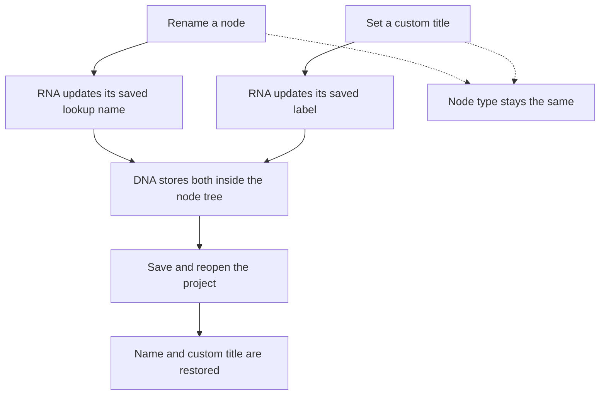

# Renaming a node and setting its title

A node has a saved name and a separate custom title. Changing either one does not change what kind of node it is.

```python
node.name = "Skin Shader"  # Saved name used to find this node.
node.label = "Human Skin"  # Custom title shown on this node.
```

For a Principled BSDF node, the type identifier remains `ShaderNodeBsdfPrincipled`. A script finds the renamed node with `tree.nodes["Skin Shader"]`. Changing only `node.label` leaves that lookup name alone.

## What is saved?

| Setting | Example | What happens? |
| --- | --- | --- |
| Node type | ShaderNodeBsdfPrincipled | Remains the same when renamed or when language changes. |
| Node name | Skin Shader | Saved in the project; used for lookup within its node tree. |
| Custom title | Human Skin | Saved separately; shown literally as the custom title. |
| Built-in title | Principled BSDF | Blender supplies the title and applies its existing display rules. |

When a custom title is supplied, Blender’s node-title helper uses it first. Otherwise it asks the node type’s label function, when present, or translates the built-in title. The built-in title and custom title are not necessarily two lines drawn together.

Save/reopen restores the node’s name and custom title. Changing interface language alone does not rename these stored fields. Node names are editable lookup names, not permanent identifiers.



[Open the rendered diagram](diagrams/node-renaming.svg).

## A node group is a different kind of item

An individual node is stored inside a node tree. It is not an ID data-block, so it does not gain `node.ui_name_translation_mark()`.

A saved node group **is** a `NodeTree` ID data-block. On this feature branch, it can use the shared author action:

```python
group.ui_name_translation_mark()
group.name = "My Tree Tool"
assert not group.ui_name_is_translatable
assert group.ui_name == "My Tree Tool"
```

The rename changes the group’s saved name and clears its translation note. Renaming back does not restore permission. The group’s individual nodes, custom titles and interface socket names remain separate user data.

`group.ui_name` demonstrates the shared helper’s chosen text. Node-group labels and registered node-tool menus/search are connected and verified separately; see [final verification](20261003_231111_verification.md). This example checks saved names and titles, rather than proving every editor display.

## Run the complete example

The [runnable script](reference/node_rename_example.py) creates a fresh material and node group. It checks node lookup, a custom title, a Vietnamese test translation for a marked group, a group rename, and a custom socket named “Density”. It saves to a temporary `.blend`, reopens it, and checks the loaded items again. Fake User keeps its unused material and group in the saved file.

Run in a separate fresh Blender process from the repository root. The script opens its temporary file; do not run it in a working project you want to keep open.

```sh
BLENDER_USER_CONFIG=/private/tmp/node-rename-example-config \
  ../build_darwin_full/bin/Blender.app/Contents/MacOS/Blender \
  --background --factory-startup --python-exit-code 1 \
  --python project_files/issues/20260924_labelling_in_i18n/version_0002/reference/node_rename_example.py
```

**Verified:** complete experiment passes independently on the rebuilt Blender 5.3 branch, exit 0. Actual save/reopen preserves the node name, custom title, type, renamed group and socket name. The group’s rename-back remains literal. Independent log: `/private/tmp/id-ui-name-node-example.log`. The rendered diagram was inspected for readable text and clipping. No new libraries or production changes.

## Where Blender handles this

DNA stores `bNode.name` and `bNode.label` inside the node tree. RNA exposes `Node.name` and `Node.label`; the name setter also handles uniqueness and updates animation paths. `bpy` uses those RNA properties.

Current implementation references: `rna_Node_name_set()` and the `Node` property registration in `source/blender/makesrna/intern/rna_nodetree.cc`; `node_label()` in `source/blender/blenkernel/intern/node.cc`. The group uses the branch’s existing `ID` RNA author actions and shared helper. The example changes no DNA layout, node type registration or socket-translation rules.
